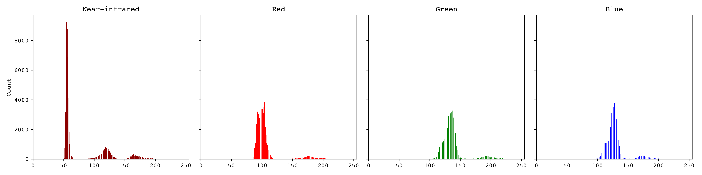
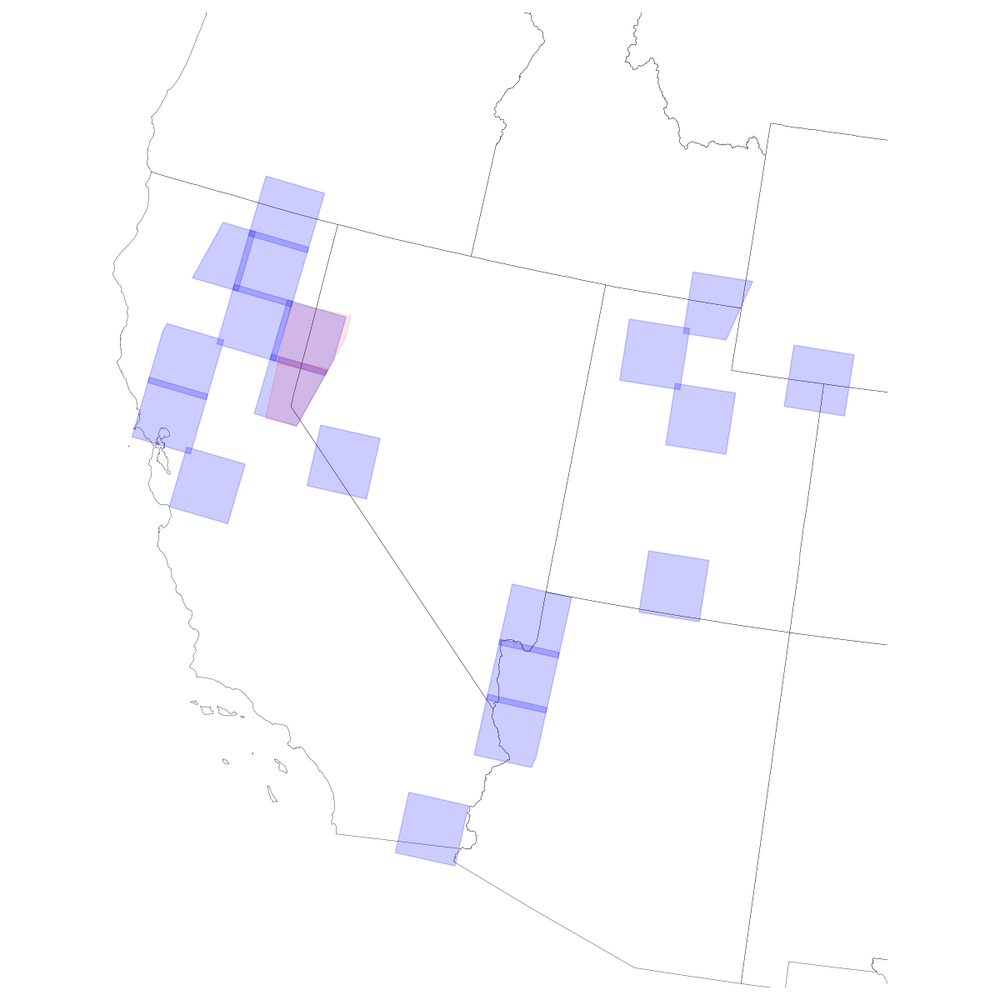
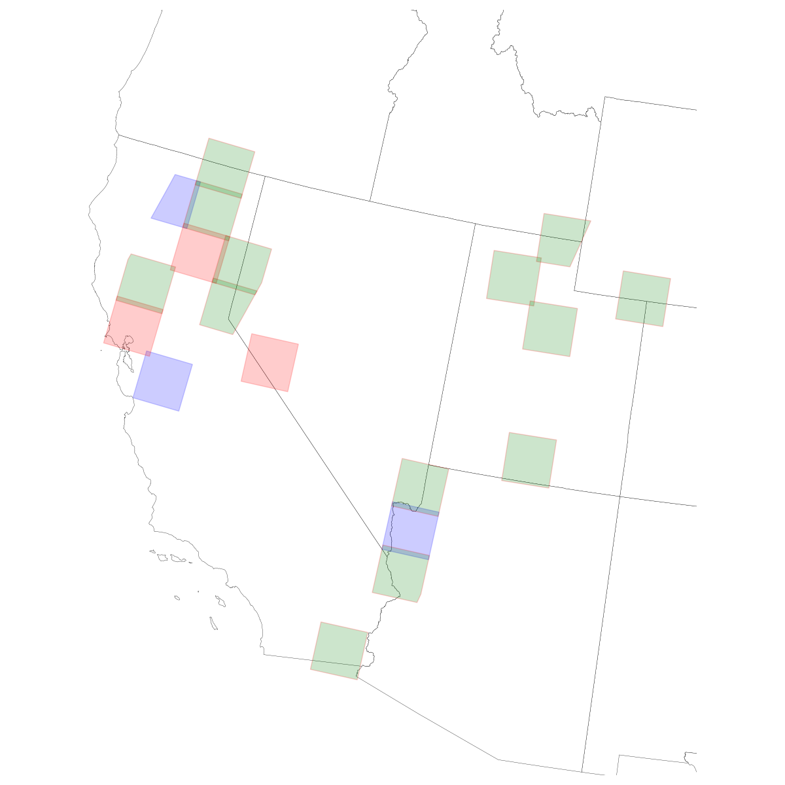
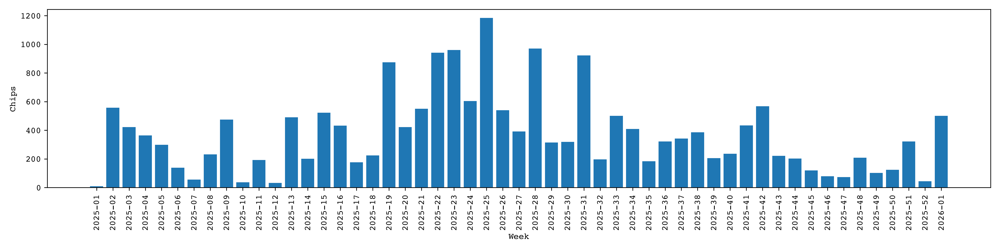
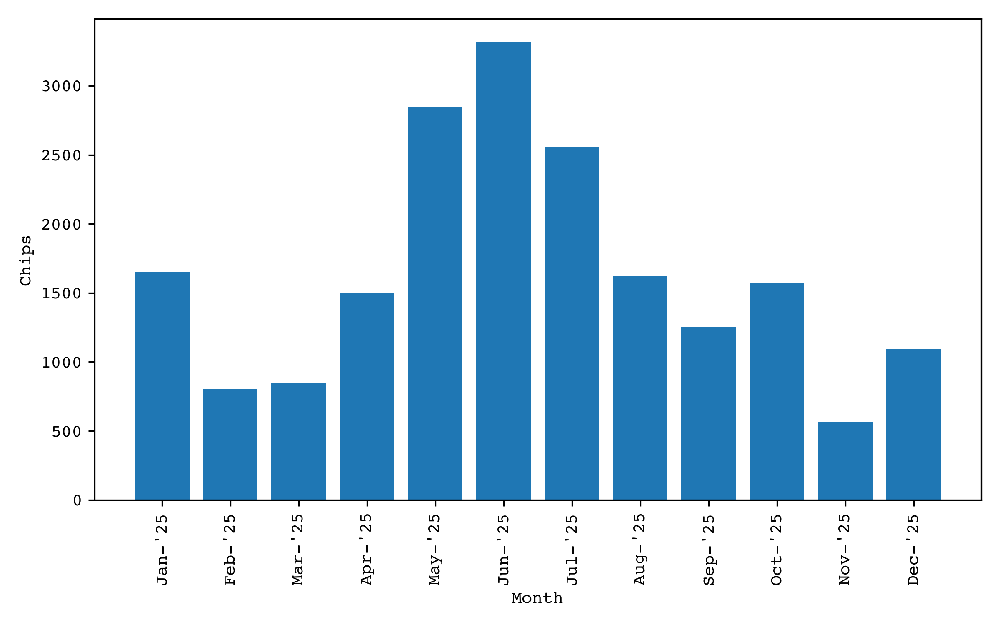
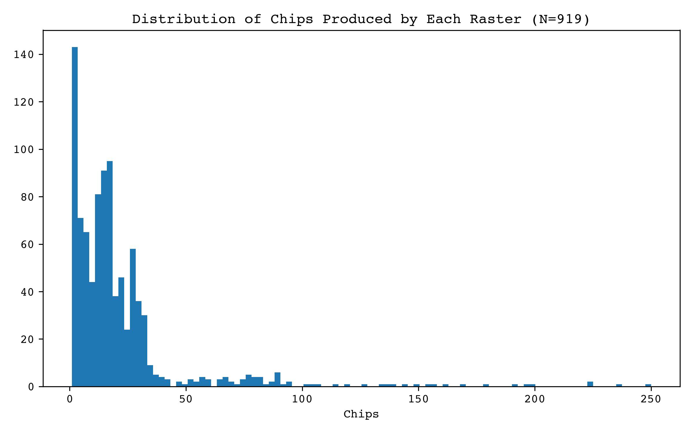
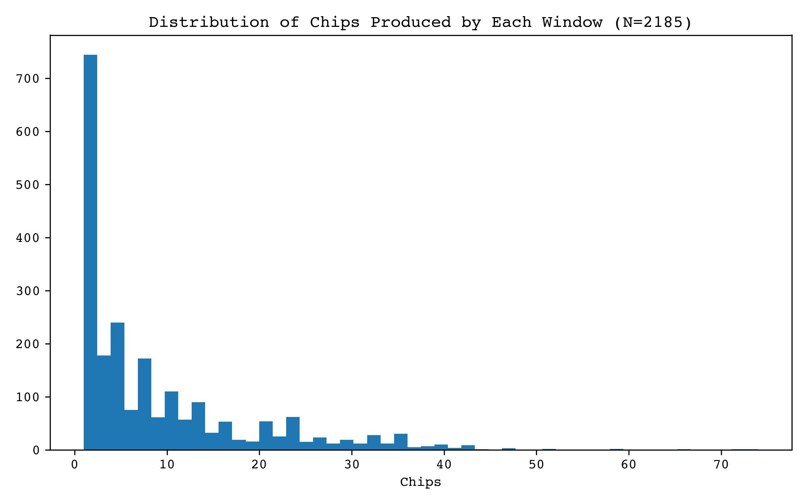
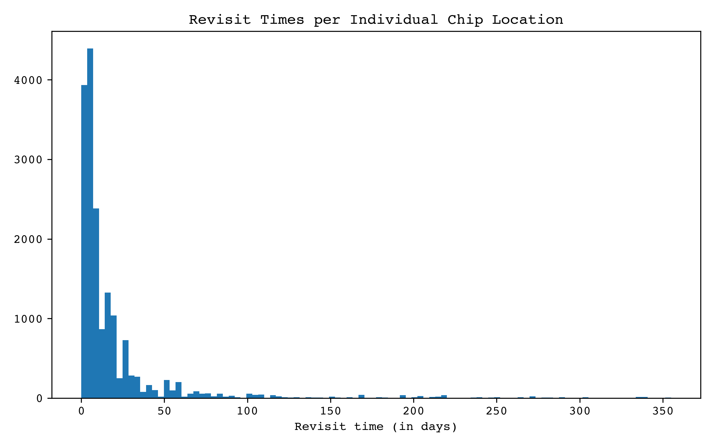

# s2dw-lakes-dataset
Pre-processing scripts and evaluation models for the S2DW dataset for inland water body segmentation.


## About
This repository contains a segmentation dataset and a brief expanantion of it.
ArXiv link: (coming soon)

Download: [Link](https://drive.google.com/file/d/1zwxtankm3ydAwxdMzaGJE1hak6TaXnAn/view?usp=sharing)

## Overview

The overall processing pipeline for this data looks somwhat like this:

```
(centroids.txt)
	|
	v
[Search Sentinel-2] -> [Drop Bad Tiles]
							|
							v
					(download_queue.txt)
```
```
(download_queue.txt)
	|
	v
[S3:Download Sentinel-2] -> [GEE:Search & Download DW]
									|
									v
							{Raw S2+DW data (~440 GB)}
```
```
{Raw S2+DW data}
	|
	v
[Align & correct] -> [Chip & Filter] -> [Train/val/test split]
											|
											v
										*Final Dataset*
```

## Contents/Scripts
This repository is composed of several scripts for both the dataset and the benchmark models ran. 

### Dataset:
There are four relevant scripts to reproduce the dataset:

- **`download_s2.py`**: Ingests points in `search/centroids.txt` to search the Sentinel-2 L2A archive via OData API, and logs this search into `.tsv` files within `search/`, and `search/download_queue.txt`. Two MGRS tiles are dropped from the results before writing these files. The outputted `.txt` queue has the  absolute paths to 10-meter band files in the ESA archive (downloaded via S3).

- **`download_dw.py`**: Takes the path of the local directory containing Sentinel-2 files to create corresponding DynamicWorld V1 id's. This requires the Google Earth Engine API to search for these ids, and to launch tasks copying matching results to a Google Drive/Google Cloud folder. 

- **`chip.py`**: Process each S2-Dw pair to produce chips. Processing is done in batches, copying a limited number (`chunk_size=50`) raster pairs to lower limit disk use in containerized/slow-disk environments.

- **`split.py`**: Splits the resulting dataset from `chips.py` (stored as a single directory) into training, testing, and validation sets using MGRS tile locations. Resulting split is stored as a new copy. 

Some additional, but not crucial files, generate statistics used during model training (standardized bands & class weights), and summarize the data:

 **`stats.py`**: Prints the overall mean and standard deviation of the bands in the training set nad calculates distribution of water vs. non-water pixels (~47/53%).

- `split.txt`: Log of the tiles selected for the traning/validation/testing split (i.e., tiles allocated) according to `split.py`.

- `figures.py`: Plots several figures summarizing the dataset (see [figures](.figures/) ). 

### Benchmark Models:

Remaining files are

- `models/`: Subdirectory containing scripts for some basic benchmark CNN/ViT training.
- `search/`: Inputs and outputs for `download_s2.py`.
	- `centroids.txt`: Input latitude and longitude to search Sentinel-2 products.
	- `download_queue.txt`: The actual downloaded Sentinel-2 images.
	- `drop.txt`: Tiles dropped.
	- `search_results.tsv`: Search result .SAFE folders and S3 paths.
	- `search_results_geometries.tsv`: .SAFE paths and polygon/geometries for each raster.

- `figures/`: Dataset figures


## How-to
### 1. Dataset
To reproduce the dataset, run (in this order):

```
[download_s2.py] -> [download_dw.py] -> [chip.py] -> [split.py]
```
The first script to search and download Sentinel-2 products can be run using

```
python3 download_s2.py
```

To download masks, you can run the following command, replacing the corresponding `S2_DIR` directory with the directory containing the previously downloaded Sentinel-2 products.
 
```
python3 download_dw.py --s2-dir {S2_DIR}
```

Once downloaded (via GEE), copy these files to a local directory (approx. ~4.5GB).

Chip the 10980x10980 rasters into 256x256 chips using:

```
python3 chip.py --work-dir {WORK_DIR} --chip-dir {CHIP_DIR} --s2-dir {S2_DIR} --dw-dir {DW_DIR}
```

where `CHIP_DIR` is the output directory to store the newly created chips. `S2_DIR` and `DW_DIR` should point to the paths of the downloaded Sentinel-2 and DynamicWorld V1 files, respectively. `WORK_DIR` must be set to any temporary working directory with fast access and sufficient memory.

### 2. Benchmark models
To fit any model to the training dataset run

```
python3 train.py --data-dir {DATA_DIR} --net-dir {NET_DIR} --log-dir {LOG_DIR} --params {JSON_FILE} --id {MODEL_ID}
```

To print the training logs for any given step run

```
python3 results.py
```
'stage 4' corresponds to the best models chosen and evaluated on the test set for the final results.


To evaluate a model on the test set do

```
python3 test.py --data-dir {DATA_DIR} --checkpoint {PTH.TAR FILE} --log-dir {LOG_DIR} --params {JSON_FILE}
```

#### Directory and additional files

- `models/`
	- `dataloader.py`: Load dataset images. See file for details.
	- `models.py`: Model definitions for all models evaluated.
	- `train.py`: Entry point. Load a model, fit to train set and log its results on validation set. . 
	- `test.py`: Load checkpoint and eval on test set.
	- `results.py`: An overall evaluation across several hyperparameter search steps.
	- `experiments.py`: Defines the hyperparameter search & steps evaluated in `results.py`.


## Results
Resulting data/chips are split into 14,682 and 2,707 chips for training and validation, and 2,242 chips for testing. Splitting for these chips was done geographically to avoid data leaks. 3 MGRS tiles were chosen for validation, and 3 for testing. Diversity is enforced within the test set by first selecting 3 UTM zones, at random, and one MGRS tile for each of these zones.  

### Dataset

Figure \ref{fig:chips_per_week} shows the temporal distribution of the resulting dataset over the year sampled.
The S2DW (this one) is a combined dataset for the particular application of deep learning models to the sematinc segmentation of aerial images (ESA's Sentinel-2 visible spectrum images). 
| RGB | NIR | Ground Truth |
| :---: | :---: | :---: |
|  |  |  |



The dataset consists of 19 MGRS tiles distributed over the western US. Two tiles of the original 21 tiles were arbitrarily dropped due to substantial overlap with tiles in an adjacent UTM zone (see red tiles below left). For the train/val/test split, 3 MGRS tiles were assigned to testing, and three to validation (see blue,red tiles below).

| Tiles Dropped  | Train/val/test (green/red/blue) |
| :---: | :---: |
|  |  |

All weeks produced rasters, with most images being retrieved during the summer (lower cloud coverage). Most rasters produced 0-50 chips. Most windows produced between 0-10 chips, and the average revisit time for a window (i.e. to produce a chip) was ~9.8 days.

<!---->

Overall configuration is 19,476 
| Chips per raster | Chips per window | Revisit time |
| :---: | :---: | :---: |
|  |  |  |

### Benchmark CNN/ViTs
Performance for a combination of semantic segmentation ViTs/CNNs was evaluated on our dataset.
Best models (by IoU score) for each the encoder-decoder combinations on the test set are:


| Encoder | Decoder | IoU | Precision | Recall | Link | 
|---|---|---|---|---| --- | 
| CNN | CNN | 90.06 | **94.84** | 94.71 | []() |
| ViT | CNN | 88.89 | 94.25 | 93.99 | []() | 
| CNN | ViT | 90.42 | 93.96 | 96.00 | []() | 
| ViT | ViT | **90.63** | 93.57 | **96.65** | []() | 

Different versions (varying in parameter size) can be downloaded from the links in the right-most column:

**Table: Test Results by Parameter Size**

| Model | IoU | Params | GFLOPs | Link |
|---|---|---|---|---|
| CNN-CNN-T | 89.14 | 4.3M | 128.8 | []() |
| ViT-CNN-T | 89.36 | 3.9M | 200.7 | []() | 
| CNN-ViT-T | **89.81** | 3.9M | 200.7 | []() | 
| ViT-ViT-T | 89.74 | 3.5M | 272.6 | []() | 
| CNN-CNN-S | 89.73 | 5.9M | 177.1 | []() | 
| ViT-CNN-S | 89.85 | 5.9M | 335.4 | []() | 
| CNN-ViT-S | 90.46 | 5.9M | 335.4 | []() | 
| ViT-ViT-S | **90.57** | 6.0M | 493.8 | []() | 
| CNN-CNN-B | 90.06 | 17.1M | 513.0 | []() | 
| ViT-CNN-B | 88.89 | 15.7M | 644.0 | []() | 
| CNN-ViT-B | 90.42 | 15.7M | 644.0 | []() | 
| ViT-ViT-B | **90.63** | 14.4M | 775.0 | []() | 
| CNN-CNN-L | 89.76 | 23.4M | 706.3 | []() | 
| ViT-CNN-L | 89.82 | 23.7M | 1026.3 | []() | 
| CNN-ViT-L | 90.76 | 23.7M | 1026.3 | []() | 
| ViT-ViT-L | **90.94** | 24.1M | 1346.8 | []() |

 
<!--
**Table: Model Configurations**

| Model Size | Block Channels | Block Layers (CNN) | Block Layers (ViT) |
|---|---|---|---|
| Tiny | C = (16,32,64,128,256) | {2,2,2,2,2} | {2,2,1,1,1} |
| Small | C = (16,32,64,128,256) | {3,3,3,3,3} | {3,3,2,2,2} |
| Base | C = (16,32,64,128,256) | {2,2,2,2,2} | {2,2,1,1,1} |
| Large | C = (16,32,64,128,256) | {3,3,3,3,3} | {3,3,2,2,2} |-->
