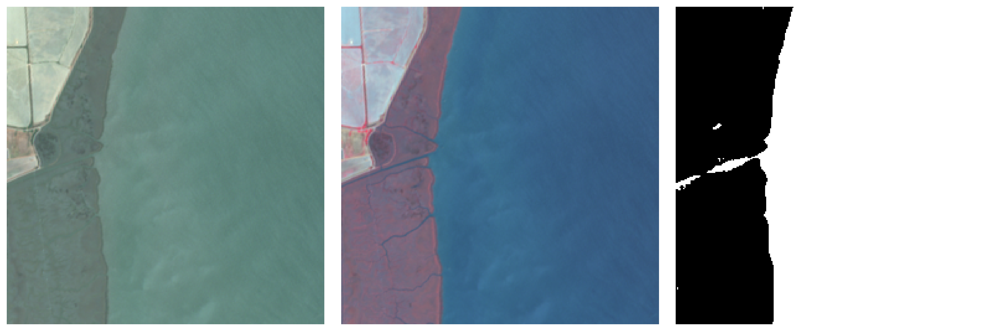
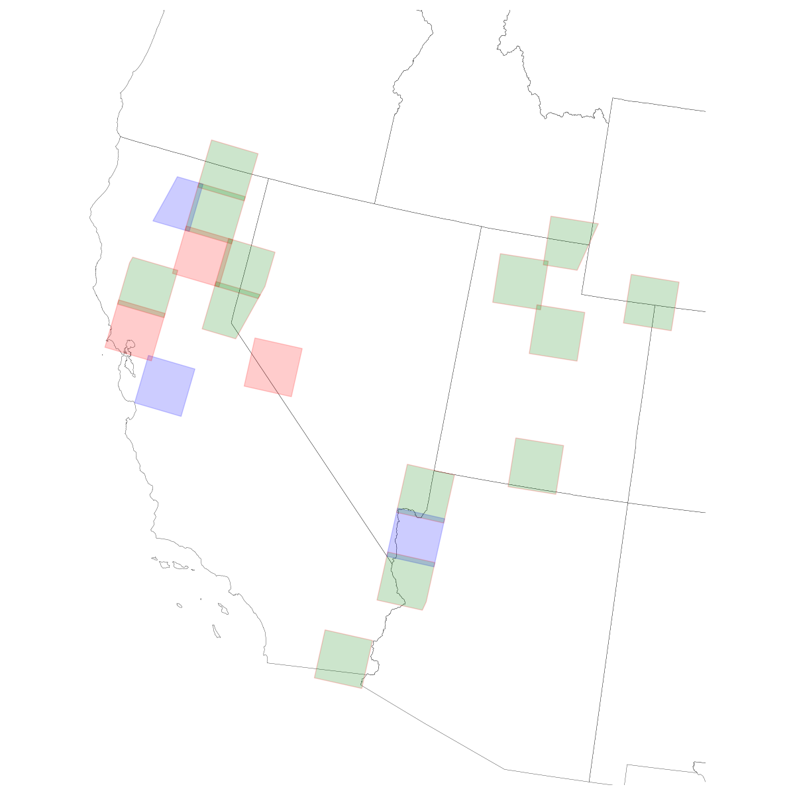
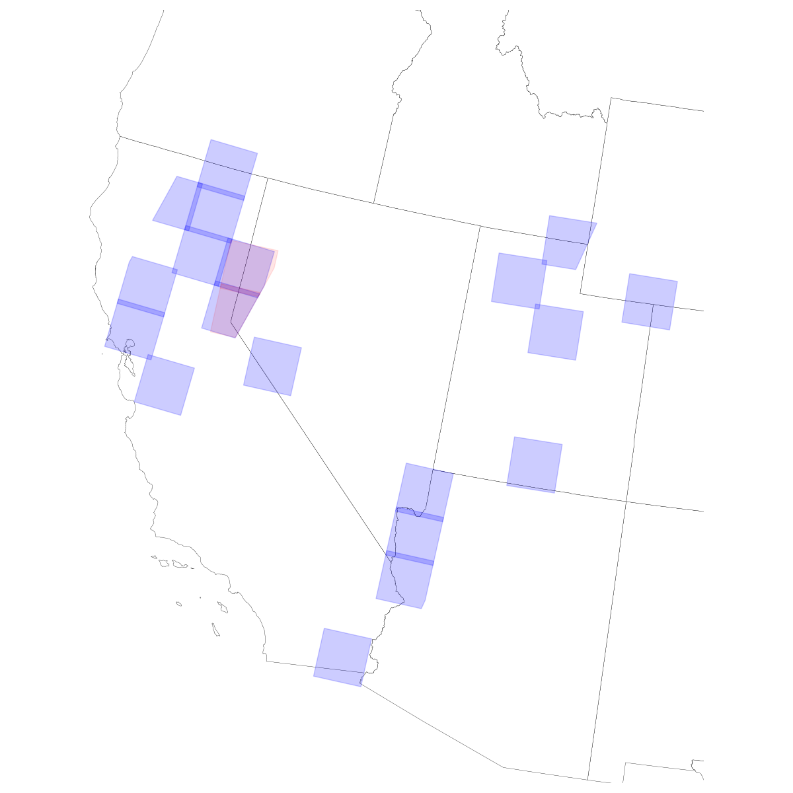
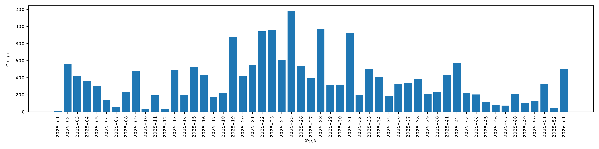
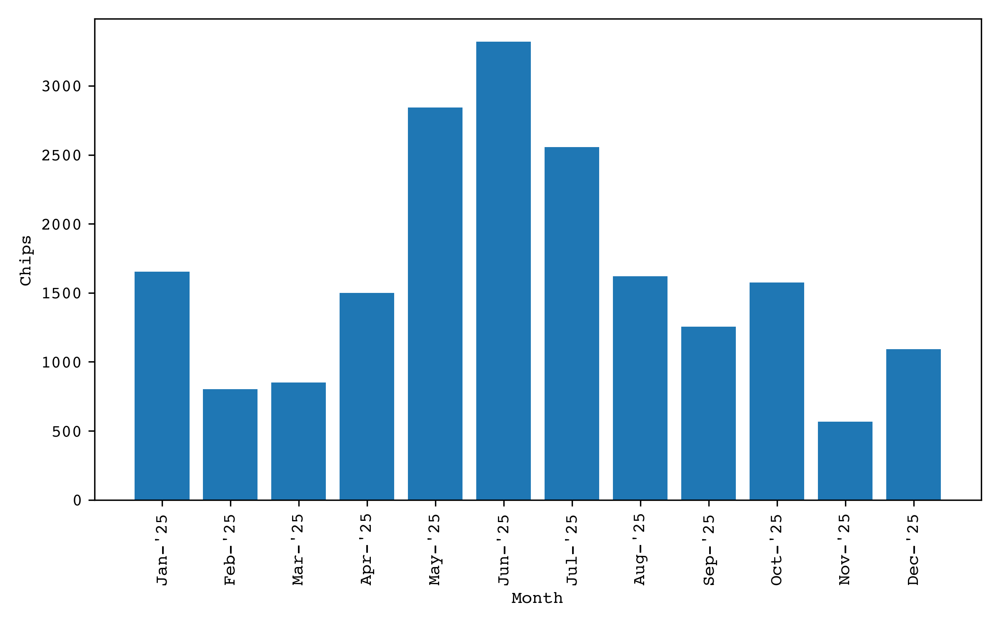
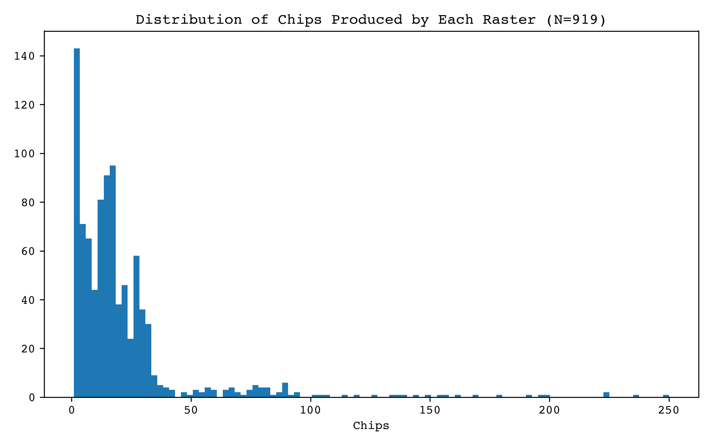
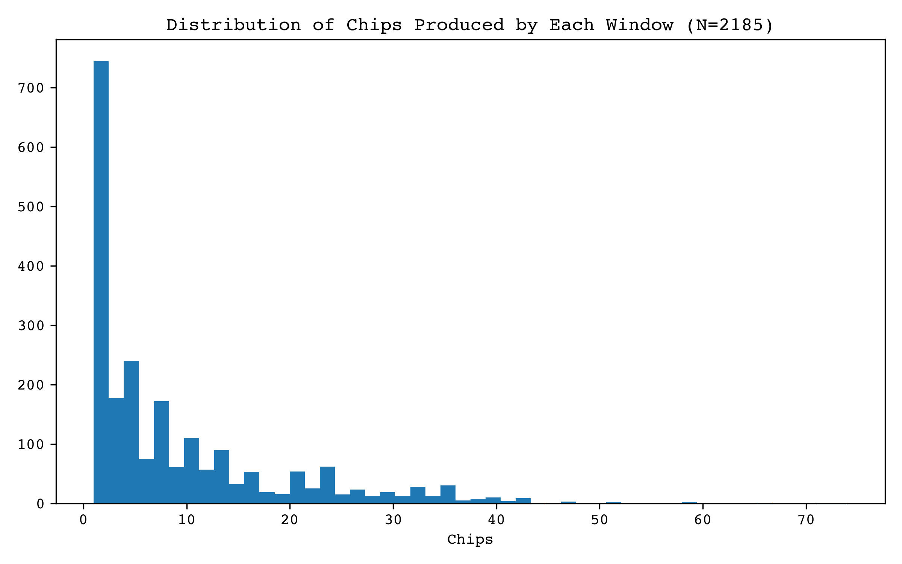
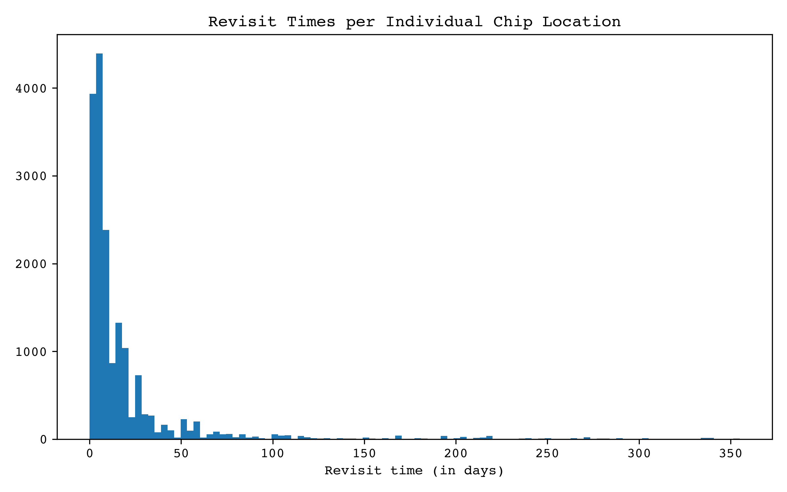

# S2DW: a Sentinel-2 dataset for inland water segmentation

S2DW pairs 10 m Sentinel-2 L2A imagery (blue, green, red, near-infrared) with binary water labels derived from Google's Dynamic World V1. The images are cut into 256 × 256 chips around lakes and reservoirs in the western United States. This repository contains the scripts that build the dataset from scratch and the CNN/ViT U-Net baselines trained on it.

<p align="center">
  
</p>
<p align="center"><em>One chip: true color (left), color infrared (center), water label in white (right).</em></p>

**Paper:** C. I. Martinez-Villar and D. T. Anderson, "A Novel Semantic Segmentation Dataset for Binary Classification of Waterbody Pixels in Sentinel-2 VNIR Images," *IGARSS* (forthcoming). <!-- TODO: arXiv / DOI link -->

**Download:** <!-- TODO: replace with Hugging Face or Zenodo --> [Google Drive](https://drive.google.com/file/d/1zwxtankm3ydAwxdMzaGJE1hak6TaXnAn/view?usp=sharing)

## Specs

| | |
|---|---|
| Imagery | Sentinel-2 L2A, bands B02, B03, B04, B08 at 10 m, scaled to 8-bit |
| Labels | Dynamic World V1 `label` band, reduced to water / not water |
| Acquisitions | 2025, scenes with ≤ 5% cloud cover |
| Area | 19 MGRS tiles in the western US, found from 20 lake and reservoir search points |
| Chips | 256 × 256 px (2.56 × 2.56 km), non-overlapping; 19,631 chips in total |
| Split | by MGRS tile, so no location appears in two splits: 13 train / 3 validation / 3 test |
| Class balance | about 47% water / 53% land (training set) |

<p align="center">
  
</p>
<p align="center"><em>Tiles by split: training (green), validation (red), test (blue).</em></p>


Download: [Link](https://drive.google.com/file/d/1zwxtankm3ydAwxdMzaGJE1hak6TaXnAn/view?usp=sharing)


## Chip Pre-processing/Selection

Each Sentinel-2 product is paired with the Dynamic World label for the same scene. Every band is clipped at its 99th percentile and scaled to 0–255. Each product is then cut into a grid of 256 × 256 windows, and a chip is kept only if all three conditions hold:

1. the label has no missing data,
2. no band has no-data (zero) pixels, and
3. water covers between 25% and 75% of the chip.

The last rule drops chips that are almost all land or all water, so every chip contains a shoreline.


## File format


```
s2dw/
├── training/
│   ├── {date}_{datastrip}_{tile}_{orbit}_{row}_{col}_B0X.tif   # 4 bands (R, G, B, NIR), uint8
│   └── {date}_{datastrip}_{tile}_{orbit}_{row}_{col}_LBL.tif   # 0 = land, 255 = water
├── validation/
└── testing/
```

Images are stored as uint8, so when reading chips are returned as 

```python
import tifffile
x = tifffile.imread("..._B0X.tif")   # (256, 256, 4) uint8
y = tifffile.imread("..._LBL.tif")   # (256, 256)    uint8, {0, 255}
```


<!--
## Contents/Scripts
This repository is composed of several scripts for both the dataset and the benchmark models ran. 

### Dataset:
There are four relevant scripts to reproduce the dataset:

- **`download_s2.py`**: Ingests points in `search/centroids.txt` to search the Sentinel-2 L2A archive via OData API, and logs this search into `.tsv` files within `search/`, and `search/download_queue.txt`. Two MGRS tiles are dropped from the results before writing these files. The outputted `.txt` queue has the  absolute paths to 10-meter band files in the ESA archive (downloaded via S3).

- **`download_dw.py`**: Takes the path of the local directory containing Sentinel-2 files to create corresponding DynamicWorld V1 id's. This requires the Google Earth Engine API to search for these ids, and to launch tasks copying matching results to a Google Drive/Google Cloud folder. 

- **`chip.py`**: Process each S2-Dw pair to produce chips. Processing is done in batches, copying a limited number (`chunk_size=50`) raster pairs to lower limit disk use in containerized/slow-disk environments.

- **`split.py`**: Splits the resulting dataset from `chips.py` (stored as a single directory) into training, testing, and validation sets using MGRS tile locations. Resulting split is stored as a new copy. 

Some additional, but not crucial files, generate statistics used during model training (standardized bands & class weights), and summarize the data:

 **`stats.py`**: Prints the overall mean and standard deviation of the bands in the training set nad calculates distribution of water vs. non-water pixels (~47/53%).

- `split.txt`: Log of the tiles selected for the traning/validation/testing split (i.e., tiles allocated) according to `split.py`.

- `figures.py`: Plots several figures summarizing the dataset (see [figures](.figures/) ). 
-->

<!--
## Dataset Details
Resulting data/chips are split into 14,682 and 2,707 chips for training and validation, and 2,242 chips for testing. Splitting for these chips was done geographically to avoid data leaks. 3 MGRS tiles were chosen for validation, and 3 for testing. Diversity is enforced within the test set by first selecting 3 UTM zones, at random, and one MGRS tile for each of these zones.  
The dataset consists of 19 MGRS tiles distributed over the western US. 3 MGRS tiles were assigned to testing, and three to validation (see blue,red tiles below).
-->
<!--| Tiles Dropped  | Train/val/test (green/red/blue) |
| :---: | :---: |
|  |  |
-->

<!---->
<!---->
<!---->
<!---->
<!-- -->

<!--### Benchmark CNN/ViTs
Performance for a combination of semantic segmentation ViTs/CNNs was evaluated on our dataset.
Best models (by IoU score) for each the encoder-decoder combinations on the test set are:
-->

## Baselines

`models/` contains U-Nets whose encoder and decoder are each either convolutional or transformer-based (`UNet_CNN_CNN`, `UNet_CNN_ViT`, `UNet_ViT_CNN`, `UNet_ViT_ViT`). They were tuned in five stages (`models/hparams/stage_*.json`): learning rate, weight decay, and batch size (160 runs, 40 per architecture), then seeds, learning-rate scheduler, model size, and a CNN stem.

Stage 1 results: peak validation IoU for the water class, RGB input, 35 epochs, taking the best of the five top-ranked runs per architecture in `models/hparams/best_stage_1.txt`.

| Encoder | Decoder | IoU (water) | Precision | Recall | 
|---|---|---|---|---| --- | 
| CNN | CNN | 90.06 | **94.84** | 94.71 |
| ViT | CNN | 88.89 | 94.25 | 93.99 |
| CNN | ViT | 90.42 | 93.96 | 96.00 |
| ViT | ViT | **90.63** | 93.57 | **96.65** |

<!-- TODO: add final test-set IoU from the paper -->

```bash
cd models
python3 train.py   --data-dir ${CHIP_DIR}_sorted --net-dir ./nets --log-dir ./logs -p hparams/stage_1.json --id 15
python3 test.py    --data-dir <cache dir> --checkpoint ./nets/<checkpoint>.pth.tar --log-dir ./logs -p hparams/experiments_1.json --test-set {s2dw,s1f11_hand,s1f11_bolivia}
python3 results.py --log-dir ./logs
```

The training container is defined in `models/docker/Dockerfile`.

## Repository layout

```
download_s2.py   search Sentinel-2 L2A (OData) and write the S3 download queue
download_dw.py   export matching Dynamic World V1 labels with Earth Engine
chip.py          normalize bands and cut filtered 256x256 chips
split.py         tile-level train/validation/test split (log in split.txt)
stats.py         band mean/std and class balance
figures.py       dataset figures (figures/)
search/          search inputs (centroids.txt) and outputs
models/          baseline U-Nets, training, testing, results, hyperparameters
```

## Citation

```bibtex
@inproceedings{martinezvillar_s2dw,
  author    = {Martinez-Villar, Carlos I. and Anderson, Derek T.},
  title     = {A Novel Semantic Segmentation Dataset for Binary Classification of Waterbody Pixels in Sentinel-2 VNIR Images},
  booktitle = {IEEE International Geoscience and Remote Sensing Symposium (IGARSS)},
  year      = {TODO},
  note      = {forthcoming}
}
```

## License

Code: MIT. Data: contains modified Copernicus Sentinel data (2025) and labels derived from Dynamic World V1 (Google and World Resources Institute, CC BY 4.0).


<!--
**Table: Test Results by Parameter Size**

| Model | IoU | Params | GFLOPs | Link |
|---|---|---|---|---|
| CNN-CNN-T | 89.14 | 4.3M | 128.8 | []() |
| ViT-CNN-T | 89.36 | 3.9M | 200.7 | []() | 
| CNN-ViT-T | **89.81** | 3.9M | 200.7 | []() | 
| ViT-ViT-T | 89.74 | 3.5M | 272.6 | []() | 
| CNN-CNN-S | 89.73 | 5.9M | 177.1 | []() | 
| ViT-CNN-S | 89.85 | 5.9M | 335.4 | []() | 
| CNN-ViT-S | 90.46 | 5.9M | 335.4 | []() | 
| ViT-ViT-S | **90.57** | 6.0M | 493.8 | []() | 
| CNN-CNN-B | 90.06 | 17.1M | 513.0 | []() | 
| ViT-CNN-B | 88.89 | 15.7M | 644.0 | []() | 
| CNN-ViT-B | 90.42 | 15.7M | 644.0 | []() | 
| ViT-ViT-B | **90.63** | 14.4M | 775.0 | []() | 
| CNN-CNN-L | 89.76 | 23.4M | 706.3 | []() | 
| ViT-CNN-L | 89.82 | 23.7M | 1026.3 | []() | 
| CNN-ViT-L | 90.76 | 23.7M | 1026.3 | []() | 
| ViT-ViT-L | **90.94** | 24.1M | 1346.8 | []() |

--> 
<!--
**Table: Model Configurations**

| Model Size | Block Channels | Block Layers (CNN) | Block Layers (ViT) |
|---|---|---|---|
| Tiny | C = (16,32,64,128,256) | {2,2,2,2,2} | {2,2,1,1,1} |
| Small | C = (16,32,64,128,256) | {3,3,3,3,3} | {3,3,2,2,2} |
| Base | C = (16,32,64,128,256) | {2,2,2,2,2} | {2,2,1,1,1} |
| Large | C = (16,32,64,128,256) | {3,3,3,3,3} | {3,3,2,2,2} |-->
